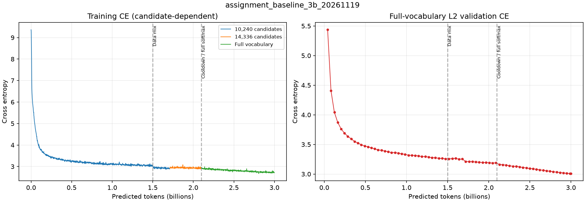

# MiniPLE: small language models, measurable improvements

Build and test an improvement to a **146,496,016-parameter language model** on **one NVIDIA RTX 3090 (24 GB)**. Choose one main track, state a hypothesis, run controlled experiments, and explain what the evidence supports. A well-explained negative result is a valid research outcome.

**3B and 50B refer to training tokens, not model parameters.** Both supplied checkpoints have the same 146.5M-parameter architecture. The default command trains a new model from random initialization for approximately 3B tokens. It does not load either supplied checkpoint.

## Source code and optional checkpoints

Get the source from the public [spindro/miniple-challenge repository](https://github.com/spindro/miniple-challenge) and the optional checkpoints from [release v1.1.0](https://github.com/spindro/miniple-challenge/releases/tag/v1.1.0). The source checkout includes code, documents, assignment and historical results, and the **frozen validation file and tokenizer**. The two full training checkpoints are separate release assets. **Scratch training needs neither checkpoint.** Training data is reconstructed locally and is not distributed.

Start with **source release v1.1.0** and follow [the installation guide](docs/SETUP.md): create the environment, verify the bundled references, prepare the training data, and launch your first experiment. The supplied requirements include the verified data-preparation dependency, `datasets==5.0.1`.

Follow [the download and distribution guide](docs/DISTRIBUTION.md). No GitHub account or invitation is required to download the public assignment. Download only what your experiment uses:

```bash
# Reference evaluation: download only the 3B-token checkpoint.
python3 scripts/download_checkpoints.py --checkpoint 3b
python3 scripts/verify_artifacts.py --checkpoints 3b

# E/F adaptation: use --checkpoint 50b and verify --checkpoints 50b instead.
```

The downloader reads its repository and release tag from `distribution.json` and verifies each checkpoint against the supplied SHA256 manifest before installing it.

## Choose a track

| Track | Main question | Starting point | Primary result |
|---|---|---|---|
| A — Quality at equal tokens | Can you learn a better model from the same token budget? | Random initialization | Lower fixed held-out next-token loss at 2,999,910,400 tokens |
| B — Token efficiency | Can you reach the baseline quality with fewer tokens? | Random initialization | Fewer tokens to validation loss ≤ 3.0082439556717873 |
| C — Training speed | Can you reach that quality sooner on one 3090? | Random initialization | Less elapsed training time to the same target |
| D — Data mixtures | Can better data selection or ordering improve learning? | Random initialization | A declared A, B, or C objective, with the model recipe controlled |
| E — Instruction tuning | Can you turn the 50B base model into a useful instruction follower? | Supplied 50B checkpoint | Held-out instruction-following quality and retained base capabilities |
| F — Italian | Can you produce a useful Italian model? | 50B checkpoint for adaptation, or a separately reported 3B scratch run | Italian quality, token efficiency, and English retention |

Architecture, optimizer, and systems ideas include MoEs, n-gram features, learning-rate or optimizer changes, training-speedrun techniques, and multi-token prediction. These are options, not a required checklist. See [the complete track briefs](docs/TRACKS.md).

## Start here

1. Read [setup and commands](docs/SETUP.md), then inspect [the baseline](docs/BASELINE.md).
2. Read [comparison rules](docs/PROTOCOL.md) before choosing your metric.
3. Study [how the code works](docs/CODE_GUIDE.md) and the [reading guide](docs/READING.md).
4. Fill in [your experiment proposal](templates/PROPOSAL.md) and make one small, testable change.
5. Submit the [report](templates/REPORT.md), raw results, code, and model artifacts described in [deliverables](docs/DELIVERABLES.md).

Agents working in this folder should read [AGENTS.md](AGENTS.md). Course staff should read [INSTRUCTOR.md](docs/INSTRUCTOR.md).

The [classroom presentation](presentation/README.md) includes an editable PowerPoint with speaker notes and a PDF copy.

## First commands

On the allocated Linux machine, clone the assignment and prepare the environment and data:

```bash
git clone --branch v1.1.0 https://github.com/spindro/miniple-challenge.git
cd miniple-challenge
python3 scripts/check_starter.py
python3 scripts/verify_artifacts.py --checkpoints none
bash scripts/install.sh
source .venv/bin/activate
python -m unittest discover -s tests -v
python -u prepare_data.py --out-dir data/ultrafineweb_3b
python train.py --data-dir data/ultrafineweb_3b --validate-data-only
(cd data/ultrafineweb_3b && sha256sum --check ../../baselines/3b/data.sha256)
```

After preparation and parity checks, make and record your experimental change before launching your candidate on an allocated GPU. Reproducing the unchanged baseline is optional when the supplied control meets your track's parity conditions:

```bash
GPU_ID=0 OUT_DIR=runs/my_candidate_3b bash scripts/train.sh
```

Preparation uses CPU, network, and disk. For A/B, you may use the supplied assignment baseline as the unchanged control without retraining it after all four full training-stream SHA256s match its canonical data manifest. Keep the frozen tokenizer/validation, source order, mixture, token accounting and seed 1337 fixed, and disclose software and numerical differences. Otherwise run an unchanged control on your corpus. For C, use the supplied timing only when the documented hardware, software, cache state, timer boundaries and comparison endpoint match; otherwise run a matched reference. The supplied complete-run endpoint is not a verified earliest saved time-to-target. For D, the supplied default-data run may be the control arm when other conditions match; otherwise run a control that isolates the intentional data change. See [the baseline](docs/BASELINE.md) and [setup](docs/SETUP.md).

## Supplied reference results

| Reference | Parameters | Predicted training tokens | Fixed L2 validation CE ↓ | Perplexity ↓ |
|---|---:|---:|---:|---:|
| Assignment 3B | 146,496,016 | 2,999,910,400 | 3.008244 | 20.251806 |
| 50B | 146,496,016 | 49,999,872,000 | 2.799718 | 16.440013 |



The training plot includes sampled-softmax objectives with different candidate counts. Their losses are diagnostic curves; **the common comparison metric is full-vocabulary next-token cross-entropy on the frozen validation set**. Auxiliary MTP or MoE losses must be reported separately.

## Folder contents

```text
AGENTS.md                 Instructions for coding agents
docs/                     Track briefs, protocol, setup, background, readings
templates/                Proposal, report, and machine-readable result template
model.py, train.py, ...   Editable training implementation
scripts/                  Install, train, check, evaluate, generate
distribution.json         Repository and release used by the checkpoint downloader
tests/                    Small CPU checks for the added loss evaluator
data/ultrafineweb_3b/      Created locally by prepare_data.py; not distributed
baselines/3b/             Assignment control, canonical data hashes, optional checkpoint
baselines/historical_3b_20261022/  Archived original 3B evidence
baselines/50b/            Original results/provenance; optional downloaded checkpoint
baselines/validation/     Frozen validation set and tokenizer, included in Git
runs/                     Your experiments; create a fresh directory for each run
```

The default size band is **131,846,415–161,145,617 total parameters** (±10%). Every stored expert and learned lookup entry counts. See the protocol for tied weights, auxiliary heads, and adaptation tracks. Dates, team size, and the available GPU-hour budget are supplied by the instructor; no deadline or allocation is implied by these files.

The supplied A/B control need not be retrained when the documented parity conditions hold. The classroom slides retain historical reference figures; this README and the protocol define the current target.
